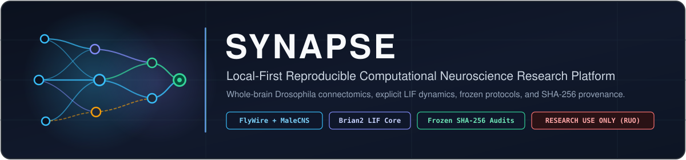
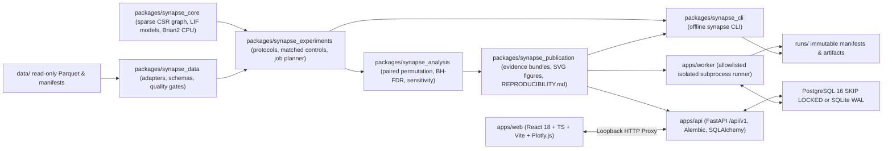

<div align="center">



<p>
  <a href="https://github.com/mburakmmm/synapse/actions/workflows/ci.yml">
    
  </a>
  
  
  
  
</p>

<p>
  <a href="#overview">Overview</a> ·
  <a href="#project-status">Project Status</a> ·
  <a href="#verified-quantitative-results">Results</a> ·
  <a href="#architecture">Architecture</a> ·
  <a href="#quickstart">Quickstart</a> ·
  <a href="#documentation-index">Docs</a> ·
  <a href="#scientific-integrity--limitations">Integrity</a> ·
  <a href="#citation--licensing">Citation</a>
</p>

</div>

---

> [!CAUTION]
> **Research Use Only (RUO):** SYNAPSE is an open-source, local-first computational neuroscience research laboratory. It is **not** a clinical decision support system, diagnostic tool, digital patient, or substitute for wet-lab experimentation. Never ingest human patient records or clinical identifiers, and never infer clinical advice, drug dosing, or human efficacy claims from adult *Drosophila melanogaster* or synthetic network simulations.

---

## Overview

**SYNAPSE** investigates circuit mechanisms grounded in adult *Drosophila melanogaster* biological connectomes using explicitly parameterized dynamical models, deterministic seed accounting, SHA-256 dataset/protocol provenance, and statistical falsification controls (zero-stimulus sham checks and structurally matched non-target controls).

Key engineering and scientific invariants (see [`AGENTS.md`](AGENTS.md)):

- **Specimen & Provenance Isolation:** Every neuron, synapse, neurotransmitter, and protocol manifest resolves to an explicit dataset release (`flywire_fafb_v630` or `malecns_v1_0`), checksum-verified source files, canonical Parquet/CSR graph SHA-256, parameter manifest hash, and immutable run directory. Node identifiers (`64`-bit integers serialized as strings) are never pooled across specimens.
- **Explicit Equations over Black Boxes:** Connectome weights (synapse counts) are modeled via inspectable Leaky Integrate-and-Fire (`shiu2024_lif` and `synapse_lif_v1`) equations inside deterministic `brian2` CPU simulations, keeping structural graphs separate from fitted or extrapolated biophysics.
- **Exploratory vs. Confirmatory Separation:** Exploratory calibration runs use separate seeds and protocols before human review freezes immutable confirmatory YAML specifications (`*.frozen.yaml`).
- **Dual-Mode Laboratory Workbench:** Run reproducible sweeps strictly offline via the `synapse` CLI or launch the loopback-bound FastAPI + PostgreSQL/SQLite + isolated subprocess worker + React/Plotly.js workbench (`compose.yaml`).

---

## Project Status

| Phase | Scope | Status | Verification & Primary Artifacts |
|---|---|---|---|
| **Phase 0 — Bootstrap** | Package DAG, schemas, `synthetic_microcircuit_v1` vertical slice, CLI, tests, CI, Graphify nav | **Verified** | Automated unit/integration checks on offline synthetic fixture |
| **Phase 1 — Biological Foundation** | Local acquisition, checksum verification, and Parquet/CSR normalization of `flywire_fafb_v630` and `malecns_v1_0` | **Verified** | Data gates passed with `0` quarantined rows; datasets gitignored locally ([FlyWire Card](docs/data-cards/flywire_fafb_v630.md), [MaleCNS Card](docs/data-cards/malecns_v1_0.md)) |
| **Phase 2 — Simulation Core** | Whole-brain `flywire_fafb_v630` computational reproduction of Shiu et al. (*Nature*, 2024) feeding circuit | **Computationally Reproduced** | `90/90` runs passed (`failed_run_count = 0`, `overall_passed = true`) ([Validation Report](docs/validation/shiu2024_reproduction_report.md)) |
| **Phase 3 — Research Laboratory** | Protocol freezing, CLI run planner, Alembic/SQLAlchemy DB, FastAPI `/api/v1`, isolated worker, React/Plotly.js UI, Docker Compose + `pg_dump`/`pg_restore` | **Verified** | API/worker/UI suites + live PostgreSQL `SKIP LOCKED` & backup/restore parity verified ([ADR-0005](docs/adr/ADR-0005-phase3-research-laboratory-architecture.md)) |
| **Phase 4 — Metabolic (`P4-MET-001`)** | Matched-control design, exploratory pilot (`N=3`), frozen confirmatory (`N=30`), robustness sensitivity (`N=6` arms), MaleCNS audit | **Confirmatory Simulation Complete** | `180/180` confirmatory + `36/36` robustness runs (`0` failed); *not* biological wet-lab validation ([Confirmatory Report](research/modules/metabolic/confirmatory_report.md)) |
| **Phase 5A — Pain (`P5-PAIN-001`)** | Adult male `malecns_v1_0` VNC GABAergic disinhibition (`EdgeMaskModulation`) vs. cell death (`N = 15` confirmatory + `N = 6` robustness) | **Confirmatory Simulation Complete** | `120/120` confirmatory (`6/6` primary `q = 9.9990e-05`) + `36/36` robustness runs (`0` failed); *not* biological validation ([Pain Report](research/modules/pain/confirmatory_report.md)) |
| **Phase 5B+ — Sleep & Addiction** | Remaining translational circuit modules | **Planned** | Gated on primary literature review and module-specific controls ([STATUS](docs/STATUS.md)) |

---

## Verified Quantitative Results

> [!IMPORTANT]
> **Claim Classification:** Every figure below reports **verified software checks** or **computational simulations conditional on connectome graphs and LIF equations**. Biological wet-lab validation is not claimed ([`AGENTS.md`](AGENTS.md) §2).

### 1. Canonical Connectome Datasets (Phase 1)

Raw datasets are intentionally excluded from Git (`data/` is gitignored) and fetched locally only after explicit user confirmation (`synapse dataset fetch ... --confirm-fetch`).

| Dataset | Specimen / Release | Neurons / Bodies | Directed Edges | Total Synapses | Canonical `graph_sha256` Prefix | Data Card |
|---|---|---:|---:|---:|---|---|
| `flywire_fafb_v630` | Adult female *Drosophila* brain (`v630`) | `127,400` | `14,687,178` | `52,793,639` | `c8fc14b9...` | [`flywire_fafb_v630.md`](docs/data-cards/flywire_fafb_v630.md) |
| `malecns_v1_0` | Adult male *Drosophila* CNS (`v1.0`, `annotated_bodies`) | `211,577` | `26,028,386` | `125,365,933` | `ef532405...` | [`malecns_v1_0.md`](docs/data-cards/malecns_v1_0.md) |

### 2. Shiu et al. (2024) Feeding Circuit Computational Reproduction (Phase 2)

Executed on whole-brain `flywire_fafb_v630` using `shiu2024_lif` (`brian2 2.10.1`, `numpy` target, `dt = 0.1 ms`, `dg_unless_refractory = true`) under [`P2-BENCH-SHIU2024.yaml`](research/protocols/P2-BENCH-SHIU2024.yaml) (`revision: 2`, `N = 30` paired seeds × `3` conditions = `90/90` succeeded runs, `failed_run_count = 0`, `1819.22 s` on 3 CPU workers; zero-stimulus sham check = `0` spikes). Full audit trail—including the Attempt 1 resource-limit log—is documented in [`shiu2024_reproduction_report.md`](docs/validation/shiu2024_reproduction_report.md) and [`ADR-0004`](docs/adr/ADR-0004-shiu2024-reproduction-fidelity.md).

| Condition | Neuron / Target | SYNAPSE Mean ± Pop SD (Hz) | Reference Mean ± Pop SD (Hz) | \|Δ\| (Hz) | Status |
|---|---|---:|---:|---:|---|
| `baseline_no_stimulus` | `MN9_right` (`720575940660219265`) | `0.000 ± 0.000` | `0.000 ± 0.000` | `0.000` | PASS |
| `sugar_grn_100hz` | `MN9_right` (`720575940660219265`) | `68.833 ± 4.243` | `67.033 ± 6.595` | `1.800` | PASS |
| `sugar_grn_100hz` | `MN9_left` (`720575940645521262`) | `49.533 ± 4.724` | `48.633 ± 4.672` | `0.900` | PASS |
| `sugar_grn_100hz` | `top_responder_1` (`720575940622695448`) | `114.500 ± 1.962` | `114.267 ± 2.097` | `0.233` | PASS |
| `sugar_grn_100hz` | `top_responder_2` (`720575940629888530`) | `102.667 ± 3.026` | `101.700 ± 3.100` | `0.967` | PASS |
| `sugar_grn_100hz` | `top_responder_3` (`720575940627383685`) | `100.967 ± 1.602` | `101.133 ± 1.875` | `0.167` | PASS |
| `sugar_grn_100hz_silence_grn15` | `MN9_right` (`720575940660219265`) | `63.600 ± 4.432` | `63.267 ± 4.732` | `0.333` | PASS |

- **GRN-15 Silencing Contrast (`MN9_right`, `N = 30`):** Mean Δ `-5.2333 Hz` (95% bootstrap CI `[-7.4342, -2.9658] Hz`) vs. reference `-3.7667 Hz` (`expected_direction = negative` -> **PASS**).

### 3. Metabolic Circuit Investigation `P4-MET-001` (Phase 4)

Pre-registered after an exploratory pilot (`P4-MET-001-pilot.yaml`, `N = 3`, `15/15` runs) and frozen immutably at [`P4-MET-001.frozen.yaml`](research/protocols/P4-MET-001.frozen.yaml) (`protocol_sha256 = d15ad4aafe1088fa1bc6afb62b58528b27e948c1f2d07c3484963eebb00bef05`, `master_seed = 20261122`, `N = 30` paired seeds × `6` conditions = `180/180` succeeded runs, `failed_run_count = 0`, `3449.42 s`). Outgoing sugar-GRN gain (`1.25x`, `1.50x`) was contrasted against baseline `50 Hz` sucrose drive and `1.50x` gain applied to `21` degree/synapse/NT-matched non-gustatory controls (`|SMD| <= 0.0431`, excluding MN9 and 1-hop GRN targets).

| Endpoint | Condition / Contrast (`N = 30` pairs) | Result / Mean Δ (Hz) | 95% Bootstrap CI (Hz) | Multiplicity (BH-FDR) |
|---|---|---|---|---|
| Control Check | `sham_zero_stimulus` | `0.000 ± 0.000 Hz` (`max_total_spikes = 0`, `30/30`) | — | — |
| `MN9_right` | `sugar_100hz_positive_control` | `67.800 ± 4.723 Hz` | — | — |
| `MN9_right` | `sugar_50hz_baseline` vs. `matched_ctrl_gain_1p50` | `20.200 ± 6.456 Hz` (`0.0000 Hz` Δ) | `[0.0000, 0.0000]` | — |
| `MN9_right` (Primary) | `gain_1p25` (`42.200 ± 5.653 Hz`) − `baseline` | `+22.0000 Hz` (SD `7.7415`) | `[+19.2667, +24.7342]` | `q = 9.999e-05` |
| `MN9_right` (Primary) | `gain_1p50` (`51.100 ± 5.326 Hz`) − `baseline` | `+30.9000 Hz` (SD `7.1936`) | `[+28.2333, +33.3667]` | `q = 9.999e-05` |
| `MN9_right` (Primary) | `gain_1p50` − `matched_ctrl_gain_1p50` (Specificity) | `+30.9000 Hz` (SD `7.1936`) | `[+28.2333, +33.3667]` | `q = 9.999e-05` |
| `MN9_left` (Secondary) | `gain_1p50` (`39.233 Hz`) − `baseline` (`15.567 Hz`) | `+23.6667 Hz` (SD `7.3688`) | `[+20.9333, +26.1667]` | `p = 9.999e-05` |

- **Exploratory Robustness & Sensitivity (`36/36` runs, `N = 6` pairs, `811.89 s`):** Positive `1.50x` Δ persisted across `synapse_lif_v1` (`dg_unless_refractory = false`, exact solver: `+34.667 ± 9.026 Hz`, exact sign-flip `p = 0.03125`) and global synaptic scale `w_syn_v ±10%` (`0.2475 mV`: `+31.500 ± 9.503 Hz`; `0.3025 mV`: `+23.500 ± 7.477 Hz`), while baseline `50 Hz` firing rate varied substantially with `w_syn_v` (`4.500` to `38.833 Hz`). See [`confirmatory_report.md`](research/modules/metabolic/confirmatory_report.md).
- **MaleCNS Cross-Specimen Audit (`malecns_v1_0`):** Structural query identified bilateral `MN9` (`16949`, `10331`) and `60` `tpGRN` cells (`50` `claw_tpGRN`, `10` `dorsal_tpGRN`), with `0` sugar-receptor (`Gr5a`/`Gr64`/sugar) modality annotations; cross-specimen simulation was intentionally deferred rather than fabricated.

### 4. Pain Circuit Investigation `P5-PAIN-001` (Phase 5A)

Executed on adult male `malecns_v1_0` (`synapse_lif_v1`, `brian2_cpu`, `exact` solver) after an exploratory pilot (`P5-PAIN-001-pilot.yaml`, `N = 3`, `24/24` runs) and immutable freeze at [`P5-PAIN-001.frozen.yaml`](research/protocols/P5-PAIN-001.frozen.yaml) (`protocol_sha256 = a379c7e1c7b264859fe777730464cd8d34807dc1772818b5c4bb4b978ed683cf`, `master_seed = 20261131`, `N = 15` paired seeds × `8` conditions = `120/120` succeeded runs, `failed_run_count = 0`, `8271.70 s`). Top `30` right middle-leg (`R-MesoLN`) mechanosensory afferents drove feedforward VNC `GABA` disinhibition vs. `26` degree/synapse/NT-matched VNC `GABA` negative controls (`|SMD| <= 0.0970`).

| Endpoint | Condition / Contrast (`N = 15` pairs, `0.0–0.8 s`) | Result / Mean Δ (Hz) | 95% Bootstrap CI (Hz) | Statistical / Multiplicity Check |
|---|---|---|---|---|
| Control Check | `sham_zero_stimulus` | `0.000 ± 0.000 Hz` (`sham_max_spikes = 0`, `15/15`) | — | Negative control PASS |
| `523539` (`ANXXX027_L`) | `acute_edge_mask` (`32.583 Hz`) − `40hz_baseline` (`11.917 Hz`) | `+20.667 Hz` (SD `2.907`; stim `[0.1,0.6) s`: `51.467 Hz`) | `[+19.331, +22.167]` | BH-FDR `q = 9.9990e-05` |
| `523539` (`ANXXX027_L`) | `acute_edge_mask` − `matched_ctrl_ablation` (`11.917 Hz`) | `+20.667 Hz` (SD `2.209`) | `[+19.500, +21.750]` | BH-FDR `q = 9.9990e-05` |
| `523539` (`ANXXX027_L`) | `gaba_cell_death` (`27.917 Hz`) − `40hz_baseline` & `matched_ctrl` | `+16.000 Hz` (SD `2.639` / `2.175`) | `[+14.667, +17.333]` | BH-FDR `q = 9.9990e-05` |
| `558778` (`AN08B012_R`) | `acute_edge_mask` (`17.333 Hz`) − `40hz_baseline` (`13.500 Hz`) | `+3.833 Hz` (SD `1.858`) | `[+3.000, +4.833]` | BH-FDR `q = 9.9990e-05` |
| `558778` (`AN08B012_R`) | `acute_edge_mask` − `matched_ctrl_ablation` (`14.000 Hz`) | `+3.333 Hz` (SD `1.391`) | `[+2.667, +4.000]` | BH-FDR `q = 9.9990e-05` |
| Matched Control Null | `matched_ctrl_ablation` − `40hz_baseline` (`523539` / `558778`) | `0.000 Hz` / `+0.500 Hz` | `[-0.919, +1.000]` / `[-0.250, +1.333]` | `p = 1.0000` / `p = 0.3544` |
| Mechanism Dissociation | `10592` (`AN08B012_L`): `acute_edge_mask` vs. `gaba_cell_death` | `+1.417 Hz` vs. `-4.500 Hz` | `[+0.500, +2.417]` vs. `[-5.667, -3.167]` | `p = 0.0213` vs. `p = 2.9997e-04` |

- **Exploratory Structural & Parametric Robustness (`36/36` runs, `N = 6` pairs, `2269.22 s`):** Positive `acute_edge_mask` amplification persisted on `523539` (`+17.083 Hz` under `shiu2024_lif`; `+20.833 Hz` at `-10% w_syn_v = 0.2475 mV`; `+15.208 Hz` at `+10% w_syn_v = 0.3025 mV`, exact sign-flip `p = 0.03125` across all `3` arms) and `558778` (`+2.708` to `+3.750 Hz`, `p = 0.03125`), while post-stimulus `[0.6, 0.8] s` persistence stayed `<= 1.667 Hz` (`<= 10.76 ms`) under L1 LIF kinetics. See [`pain/confirmatory_report.md`](research/modules/pain/confirmatory_report.md) and [`ADR-0006`](docs/adr/ADR-0006-phase5-pain-vnc-disinhibition.md).

---

## Architecture

SYNAPSE enforces a one-way dependency DAG verified by AST tests ([`test_import_boundaries.py`](tests/unit/test_import_boundaries.py)): the scientific kernel never imports API, ORM, or web frameworks, and neither the HTTP API nor the React workbench duplicates numerical execution.



- **Sparse Orientation (`packages/synapse_core`):** `row = postsynaptic_index`, `col = presynaptic_index`, so `W @ pre_activity` computes postsynaptic input cleanly.
- **Allowed Worker Jobs (`apps/worker`):** Strictly allowlisted (`protocol_experiment`, `analysis`, `export_bundle`); no arbitrary user scripts, untrusted pickle loading, or Docker socket mounts.
- **Hardware Baseline:** Reference execution runs on CPU (`brian2 2.10.1`, Python `3.12`). `brian2_cuda` GPU acceleration is strictly opt-in on validated Linux CUDA environments and remains `verified = false` on native Windows.

---

## Quickstart

Requirements: Python `3.12`, [`uv`](https://docs.astral.sh/uv/), and Git (plus Docker Compose / Node `22` if running the web workbench).

### 1. Offline Scientific CLI & Synthetic Vertical Slice

```sh
# Install pinned Python workspace dependencies from uv.lock
uv sync --locked

# Check local Python environment, simulation backend, and Graphify status
uv run synapse doctor --json

# Run the complete synthetic pipeline (ingest -> simulate -> analyze -> export)
uv run synapse run synthetic-demo --work-dir runs/phase0_synthetic_demo --seeds 5 --json
```

### 2. Local Research Workbench (Docker Compose + PostgreSQL + Web UI)

All container services run as non-root (`10001:10001`), mount `./data` read-only, and bind ports exclusively to `127.0.0.1` ([`compose.yaml`](compose.yaml)):

```sh
# Configure local credentials (never commit .env)
cp .env.example .env
# Edit POSTGRES_PASSWORD in .env, then launch Postgres + API + Worker + Web UI:
docker compose up --build
```

Once healthy:
- Web Workbench: `http://127.0.0.1:5173`
- FastAPI Health / OpenAPI: `http://127.0.0.1:8000/api/v1/health`

### 3. Inspecting Biological Plans & Validating Protocols (Offline)

```sh
# Inspect registered datasets & size/license fetch plans (does not download)
uv run synapse dataset list --json
uv run synapse dataset plan flywire_fafb_v630 --json

# Validate an immutable frozen protocol & LIF parameter manifest
uv run synapse protocol validate research/protocols/P4-MET-001.frozen.yaml --json
uv run synapse model list --json

# Dry-run resource estimation & job planning (when local curated dataset is present)
uv run synapse run plan --protocol research/protocols/P4-MET-001.frozen.yaml --dataset-dir data/curated/flywire_fafb_v630 --json
```

---

## Verification, CI & Graphify Navigation

Every change is verified against [`.github/workflows/ci.yml`](.github/workflows/ci.yml). Tests gated on local gitignored `data/` or `runs/` skip cleanly when absent in fresh CI environments.

```sh
# Python lint, formatting, static types, and fast offline test suite
uv run ruff check .
uv run ruff format --check .
uv run mypy packages apps/api apps/worker tests
uv run pytest -m "not slow and not gpu and not external" -v

# Web workbench (apps/web)
cd apps/web
npm ci
npm run typecheck
npm run test
npm run build
```

Graphify code-only navigation (`graphifyy 0.9.113`, installed outside `uv.lock`) indexes source, schemas, tests, and public docs while ignoring `data/`, `runs/`, `.venv/`, and `graphify-out/` via [`.graphifyignore`](.graphifyignore) and [`.graphifyrc`](.graphifyrc):

```sh
GRAPHIFY_QUERY_LOG_DISABLE=1 graphify update .
GRAPHIFY_QUERY_LOG_DISABLE=1 graphify query "Where is RunManifest created and persisted?" --budget 1200 --depth 2
```

---

## Documentation Index

| Document | Topic |
|---|---|
| [`AGENTS.md`](AGENTS.md) | Authoritative repository engineering, reproducibility, and scientific integrity contract |
| [`docs/STATUS.md`](docs/STATUS.md) | Current phase gates, verified checks, limitations, and immediate next tasks |
| [`docs/architecture/repository_boundaries.md`](docs/architecture/repository_boundaries.md) | Package import DAG and separation rules |
| [`docs/adr/`](docs/adr/ADR-0001-bootstrap-architecture-and-licensing.md) | Architecture Decision Records (`ADR-0001` through `ADR-0006`) |
| [`docs/data-cards/`](docs/data-cards/flywire_fafb_v630.md) | Checksum-verified dataset cards (`flywire_fafb_v630.md`, `malecns_v1_0.md`) |
| [`docs/model-cards/shiu2024_lif.md`](docs/model-cards/shiu2024_lif.md) | Parameter manifest and dynamical limits of `shiu2024_lif` |
| [`docs/validation/shiu2024_reproduction_report.md`](docs/validation/shiu2024_reproduction_report.md) | Phase 2 `90/90` Shiu et al. (2024) reproduction benchmark report |
| [`research/modules/metabolic/confirmatory_report.md`](research/modules/metabolic/confirmatory_report.md) | Phase 4 `P4-MET-001` confirmatory (`180/180`), robustness (`36/36`), and MaleCNS audit report |
| [`research/modules/metabolic/evidence_register.md`](research/modules/metabolic/evidence_register.md) | Phase 4 literature register anchored in `research/literature/source_register.yaml` |
| [`research/modules/pain/confirmatory_report.md`](research/modules/pain/confirmatory_report.md) | Phase 5A `P5-PAIN-001` confirmatory (`120/120`) and robustness (`36/36`) report on `malecns_v1_0` |
| [`research/modules/pain/evidence_register.md`](research/modules/pain/evidence_register.md) | Phase 5A adult VNC pain/disinhibition literature register (`source_register.yaml`) |
| [`docs/security/operations_and_backup.md`](docs/security/operations_and_backup.md) | Loopback security boundaries, container hardening, and SQLite/PostgreSQL backup/restore procedures |
| [`CONTRIBUTING.md`](CONTRIBUTING.md) · [`SECURITY.md`](SECURITY.md) | Contribution checklist and vulnerability disclosure policy |

---

## Scientific Integrity & Limitations

1. **Structural Connectivity ≠ Measured Electrophysiology:** Synapse counts are not direct physical conductances, upstream `flywire_fafb_v630` signs are coarse excitatory/inhibitory assignments, and neurotransmitter identities alone do not fix postsynaptic receptor kinetics.
2. **Zero Spontaneous Noise in L1 `shiu2024_lif`:** Because unstimulated LIF neurons rest at `-52 mV` below the `-45 mV` threshold without spontaneous noise, scaling outgoing weights of undriven matched controls yields `0.000 Hz` delta; specificity controls evaluate structural routing selectivity under driven input rather than tonic background suppression.
3. **Global Synaptic Scale Sensitivity:** While the `+1.50x` sugar-GRN effect remains positive across `w_syn_v ±10%` and `synapse_lif_v1`, absolute `50 Hz` baseline firing shifts strongly (`4.500 Hz` to `38.833 Hz`), underscoring the need for biological calibration before extrapolating quantitative firing thresholds.
4. **Reproducibility ≠ Biological Validation:** Passing unit tests, reproducing published LIF equations, and passing pre-registered simulation contrasts establish **computational** correctness only; wet-lab experimental validation in adult *Drosophila* remains external to this computational benchmark.

---

## Citation & Licensing

- **Software License:** Proposed under the **Apache License 2.0** ([`LICENSE`](LICENSE)).
- **Data & Upstream Notices:** Connectome datasets (`FlyWire/FAFB`, `MaleCNS v1.0`) and upstream reference baselines (`philshiu/Drosophila_brain_model`, `Brian2`) retain their original licenses and attribution terms documented in [`THIRD_PARTY_NOTICES.md`](THIRD_PARTY_NOTICES.md).
- **Citation:** See [`CITATION.cff`](CITATION.cff) (or use GitHub's *"Cite this repository"* button).
